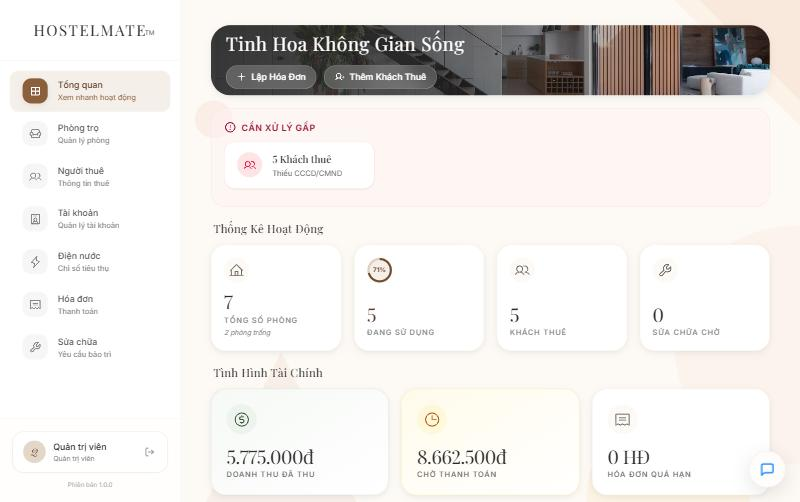
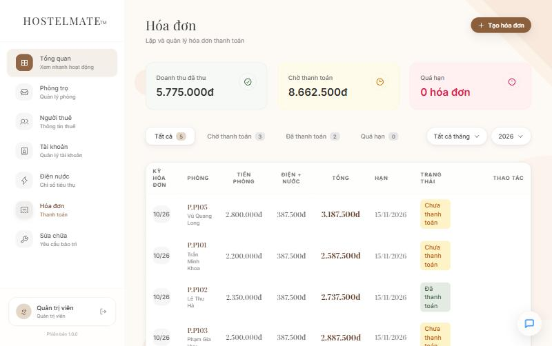
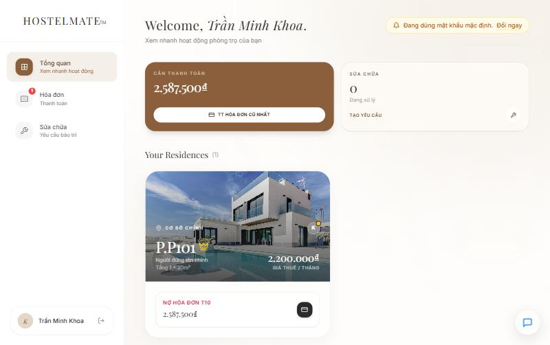
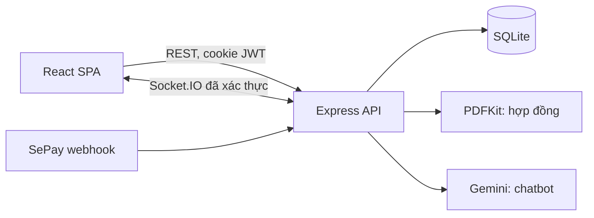
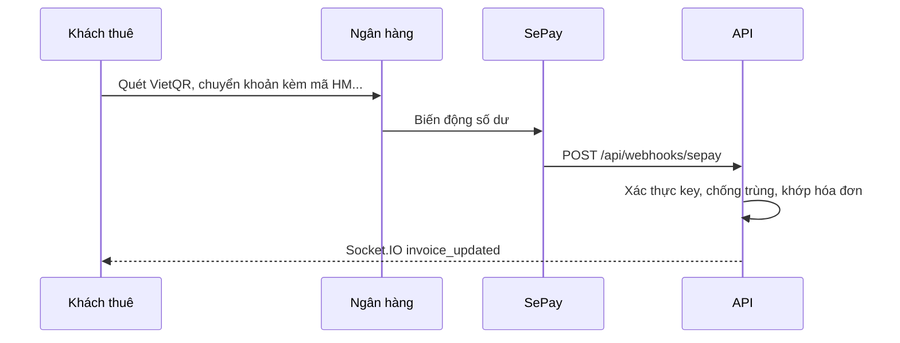

# HostelMate

Hệ thống web quản lý phòng trọ cho chủ trọ và khách thuê: phòng, hợp đồng, chỉ số điện nước, hóa đơn thanh toán bằng VietQR, yêu cầu sửa chữa và chatbot AI.

> **Chủ dự án và người phát triển chính:** Nguyễn Văn Bảo. Phát triển theo phương pháp vibe coding với sự hỗ trợ của AI.



| Quản lý hóa đơn | Trang khách thuê |
|---|---|
|  |  |

## Tính năng

**Chủ trọ (Admin)**
- Thống kê phòng, doanh thu và các việc cần xử lý
- Quản lý phòng, người thuê, hợp đồng (xếp phòng, gia hạn, thanh lý)
- Cấp, reset, khóa và thu hồi tài khoản khách thuê
- Ghi chỉ số điện nước, tạo và xác nhận hóa đơn, xuất CSV
- Tiếp nhận, phân công và theo dõi yêu cầu sửa chữa theo thời gian thực

**Khách thuê**
- Xem phòng đang thuê, người ở cùng và hợp đồng
- Ký hợp đồng trực tuyến và tải PDF
- Xem hóa đơn, thanh toán bằng mã VietQR
- Gửi và theo dõi yêu cầu sửa chữa
- Hỏi chatbot Gemini về dữ liệu của chính mình (cần `GEMINI_API_KEY`)

## Công nghệ

| Phần | Công nghệ |
|---|---|
| Frontend | React 18, TypeScript, Vite, Tailwind CSS |
| Backend | Node.js, Express, Socket.IO, PDFKit |
| Cơ sở dữ liệu | SQLite (`node:sqlite`) |
| Xác thực | JWT trong cookie httpOnly, bcrypt, Google Sign-In |
| Kiểm thử và CI | Jest, Supertest, Vitest, Playwright, ESLint, GitHub Actions |

## Kiến trúc



```text
server/
  server.js             Khởi tạo app, middleware, đăng ký route
  db.js                 Schema, seed và lớp truy vấn SQLite
  integrated-routes.js  Xác thực, cài đặt, yêu cầu của khách thuê, webhook SePay
  contracts.js          Hợp đồng PDF, chữ ký, cổng khách thuê
  src/routes/           Phòng, người thuê, hợp đồng, điện nước, hóa đơn, sửa chữa, AI
  src/middleware/       Xác thực HTTP và Socket.IO
  src/utils/            Ánh xạ dữ liệu, kiểm tra quyền truy cập
  tests/                Test tích hợp API
src/
  admin/                Giao diện chủ trọ
  pages/, components/   Giao diện khách thuê và thành phần dùng chung
```

## Chạy dự án

Yêu cầu Node.js 22.13 trở lên (dùng module SQLite có sẵn của Node, không cần build thư viện native).

```bash
npm install
npm --prefix server install
cp .env.example .env
npm run dev:all
```

Mở `http://localhost:5173` và đăng nhập bằng `admin` / `123456`. Tài khoản này chỉ tự tạo ở môi trường phát triển. Database ban đầu trống; hãy tạo phòng, người thuê rồi cấp tài khoản cho khách trong mục **Tài khoản**. Mật khẩu khách thuê chỉ hiển thị ngay sau khi cấp.

Trên Windows có thể chạy `START_HOSTELMATE.bat`. Lệnh `npm run reset-db` đưa database về trạng thái sạch.

### Triển khai

Ở production, backend phục vụ luôn frontend đã build nên chỉ cần một tiến trình:

```bash
npm install && npm --prefix server install
npm run build
NODE_ENV=production JWT_SECRET=<chuoi-ngau-nhien> ADMIN_INITIAL_PASSWORD=<mat-khau> node server/server.js
```

Server từ chối khởi động nếu thiếu `JWT_SECRET`, hoặc thiếu `ADMIN_INITIAL_PASSWORD` khi chưa có Admin. Cookie đăng nhập yêu cầu HTTPS. Cần ổ đĩa bền vững cho file SQLite (đặt qua `DATABASE_PATH`) và thư mục `server/uploads`.

## Thanh toán

Mã **VietQR** được tạo ngay trên trình duyệt theo chuẩn EMVCo, từ thông tin ngân hàng trong `.env`. Admin xác nhận thanh toán thủ công trên trang hóa đơn.

**Webhook SePay** tự động xác nhận hóa đơn khi có tiền vào tài khoản. Để bật, điền `SEPAY_WEBHOOK_API_KEY` và cấu hình URL `/api/webhooks/sepay` trên SePay; khi chưa có key, webhook trả về 503. Luồng xử lý gồm:

- Xác thực API key, từ chối mọi request khi chưa cấu hình key
- Bỏ qua giao dịch chuyển ra và giao dịch không khớp mã hóa đơn
- Chống xử lý trùng theo mã giao dịch
- Cộng dồn khi chuyển thiếu: hóa đơn sang `review_needed`, đủ tiền mới sang `paid`
- Cập nhật giao diện qua Socket.IO



## Bảo mật

- API yêu cầu đăng nhập và phân quyền theo vai trò; khách thuê chỉ truy cập được dữ liệu của mình và phòng đang thuê
- Mật khẩu băm bằng bcrypt, không bao giờ trả về qua API; mật khẩu tạm được sinh ngẫu nhiên ở server
- Giới hạn số lần đăng nhập sai; tài khoản bị khóa mất phiên đăng nhập ngay
- Kết nối Socket.IO và chatbot AI đều yêu cầu đăng nhập; chatbot giới hạn 20 tin nhắn mỗi phút
- Header bảo mật bằng Helmet; ở production chỉ chấp nhận CORS từ `CLIENT_ORIGIN`

## Kiểm thử

```bash
npm run lint
npm run typecheck
npm test
npm run test:server -- --coverage
npx playwright install chromium
npm run test:e2e
```

| Loại | Công cụ | Số test | Phạm vi |
|---|---|---|---|
| Tích hợp API | Jest, Supertest | 66 | Phân quyền, mật khẩu, nghiệp vụ, logic webhook SePay |
| Đơn vị | Vitest | 3 | Tạo dữ liệu mã VietQR |
| Đầu cuối | Playwright | 12 | Các luồng chính trên trình duyệt Chromium thật |

Test đầu cuối tự khởi động API và frontend với cổng và database riêng, nên không đụng dữ liệu đang phát triển. Các luồng được kiểm tra:

- Đăng nhập, giữ phiên, đăng xuất, khóa tài khoản, chặn khách thuê khỏi chức năng quản lý
- Admin tạo phòng, thêm người thuê, xếp phòng, cấp tài khoản; khách đăng nhập thấy đúng phòng
- Hiển thị VietQR, webhook SePay cập nhật hóa đơn ngay trên màn hình, chuyển thiếu tiền
- Khách gửi yêu cầu sửa chữa, Admin nhận ngay qua Socket.IO, xử lý xong và khách xác nhận
- Ký hợp đồng bằng chữ ký tay và tải PDF
- Giao diện điện thoại: menu trượt và không tràn ngang trên các trang

Coverage backend đo trên toàn bộ mã server là **khoảng 64% số dòng**, CI yêu cầu tối thiểu 60%. Phần chưa được phủ nhiều nhất là chatbot AI, đăng nhập Google và proxy ảnh VietQR.

## Hướng phát triển

- Mở rộng test đầu cuối sang nhập điện nước và lập hóa đơn trên giao diện
- Chuyển sang PostgreSQL khi có nhiều cơ sở
- Hợp nhất bộ component UI của Admin và khách thuê
- Tách `integrated-routes.js` theo từng phân hệ

Tài liệu endpoint: [API.md](API.md).
